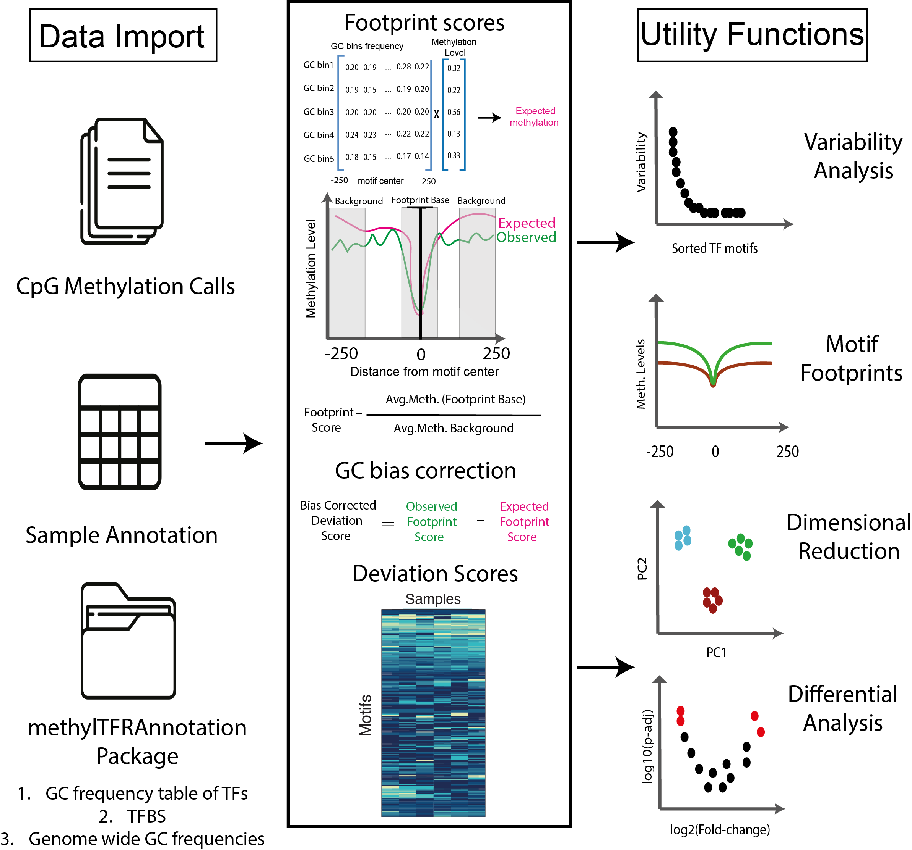

# methylTFR: DNA Methylation Signatures in TFBS

## Introduction

DNA methylation modulates transcription factor (TF) binding and plays an
important role in regulating gene expression. TF activity is usually
inferred from gene expression or from chromatin accessibility aggregated
over TF binding motifs. `methylTFR` infers it from DNA methylation
instead. It summarises methylation at the binding sites of each motif
and reports one activity score per TF and sample, rather than per locus.
The result is low-dimensional, interpretable and directly comparable to
accessibility- and expression-based measures.

`methylTFR` takes CpG-level methylation calls from bulk or aggregated
single-cell experiments, together with a sample annotation file. For
each motif, it compares methylation at the centre of the binding sites
with the flanking regions (the **observed deviation**). Because
methylation depends on local GC content, it also computes the deviation
expected from the GC content of the motif and the genome-wide GC
distribution (the **expected deviation**). The difference between the
two is the bias-corrected deviation score.

The genome-specific annotations (binding sites, motif GC frequency
tables and the genome-wide GC distribution) are provided by the
`methylTFRAnnotation` packages for hg38 and mm10, or can be built for
any assembly with `methylTFRAnnotationBuilder`. The scores can then be
used for dimensionality reduction, differential activity testing,
variability analysis and footprint plots, all included in the package.

The method and its applications are described in the [methylTFR
preprint](https://www.biorxiv.org/content/10.64898/2026.09.29.755279v1).



### Related Bioconductor packages

| Package | Input | Output unit | Needs expression or groups? |
|----|----|----|----|
| *[chromVAR](https://bioconductor.org/packages/3.23/chromVAR)* | Chromatin accessibility counts | Motif x sample | No |
| *[ELMER](https://bioconductor.org/packages/3.23/ELMER)* | Methylation (mainly arrays) + expression | Probe-gene pairs, TFs | Expression and groups |
| *[RnBeads](https://bioconductor.org/packages/3.23/RnBeads)*, *[methylKit](https://bioconductor.org/packages/3.23/methylKit)*, *[DSS](https://bioconductor.org/packages/3.23/DSS)*, *[bsseq](https://bioconductor.org/packages/3.23/bsseq)*, *[dmrseq](https://bioconductor.org/packages/3.23/dmrseq)*, *[DMRcate](https://bioconductor.org/packages/3.23/DMRcate)* | CpG methylation | CpG, region or DMR | Groups for differential tests |
| *[LOLA](https://bioconductor.org/packages/3.23/LOLA)* | Region sets (e.g. DMRs) | Enrichment per comparison | A thresholded query set |
| *[viper](https://bioconductor.org/packages/3.23/viper)*, *[dorothea](https://bioconductor.org/packages/3.23/dorothea)*, *[decoupleR](https://bioconductor.org/packages/3.23/decoupleR)* | Expression + regulons | TF x sample | Expression |
| `methylTFR` | CpG methylation | Motif x sample | No |

`methylTFR` is closest to
*[chromVAR](https://bioconductor.org/packages/3.23/chromVAR)*, which
scores motif deviations per sample from chromatin accessibility;
`methylTFR` does the same from methylation, against a GC-based
expectation. *[ELMER](https://bioconductor.org/packages/3.23/ELMER)*
also infers TFs from methylation, but needs matched expression and works
on differential probes. The CpG and DMR packages give no TF-level
summary, and `methylTFR` can read an `RnBeads` object directly.
*[LOLA](https://bioconductor.org/packages/3.23/LOLA)* returns enrichment
per comparison rather than a score per sample. Expression-based tools
such as *[viper](https://bioconductor.org/packages/3.23/viper)*
complement `methylTFR`. Motif matching upstream, when the annotation
packages are built, uses
*[motifmatchr](https://bioconductor.org/packages/3.23/motifmatchr)*,
*[TFBSTools](https://bioconductor.org/packages/3.23/TFBSTools)* and
*[JASPAR2020](https://bioconductor.org/packages/3.23/JASPAR2020)*.

## Installation

`methylTFR` is currently under review for Bioconductor. Until it is
accepted, install the development version from GitHub:

``` r

if (!requireNamespace("remotes", quietly = TRUE)) {
    install.packages("remotes")
}
remotes::install_github("EpigenomeInformatics/methylTFR")
```

Once accepted, it will be installable with:

``` r

if (!requireNamespace("BiocManager", quietly = TRUE)) {
    install.packages("BiocManager")
}

BiocManager::install("methylTFR")
```

## Getting Started

To get started with **methylTFR**, load the package and its
dependencies:

``` r

library(methylTFR)
```

### Read a Sample File

The
[`readMethylome()`](https://epigenomeinformatics.github.io/methylTFR/reference/readMethylome.md)
function is used to import single-sample DNA methylation data into a
`GRanges` object. It supports several common file formats, including
`EPP`, `ALLC`, `BisSNP`, `bismarkCytosine`, `bismarkCov`, and `ENCODE`
bedMethyl.

You can optionally filter out low-coverage sites using the
`cov_threshold` parameter (default = 1), which excludes positions with
insufficient read support.

Below is an example of reading an example `EPP`-formatted file provided
in the package:

``` r

epp_path <- system.file("extdata", "epp.tsv.gz", package = "methylTFR")
epp <- readMethylome(epp_path, "EPP")
epp
#> GRanges object with 6 ranges and 2 metadata columns:
#>       seqnames          ranges strand |     score  coverage
#>          <Rle>       <IRanges>  <Rle> | <numeric> <numeric>
#>   [1]     chr1 3010957-3010958      + |     1.000        27
#>   [2]     chr1 3010959-3010960      - |     0.500         7
#>   [3]     chr1 3010971-3010972      + |     1.000        20
#>   [4]     chr1 3010973-3010974      - |     0.500        20
#>   [5]     chr1 3011025-3011026      + |     0.814        70
#>   [6]     chr1 3011027-3011028      - |     0.500       100
#>   -------
#>   seqinfo: 1 sequence from an unspecified genome; no seqlengths
```

## Annotation Resources

Computing expected deviations requires precomputed annotations for the
genome of interest: transcription factor binding sites, a genome-wide GC
distribution, and per-motif GC frequency tables. These are distributed
separately from `methylTFR`, in an annotation package named after the
assembly, for example `methylTFRAnnotationHg38`, because the binding
sites alone take several gigabytes for a full motif set.

With the annotation package installed, the three resources are retrieved
as follows:

``` r

library(methylTFRAnnotationHg38)

tf_bindsites <- getTFbindsites(motifSet = "jaspar2020")
gcfreqs <- getGCfreq(motifSet = "jaspar2020")
gc_dist <- getGenomeGC()
```

To build annotations for a different assembly, motif set, or region
restriction, use
[`methylTFRAnnotationBuilder`](https://github.com/EpigenomeInformatics/methylTFRAnnotationBuilder).

The examples in this vignette instead use a small `BATF` subset bundled
with `methylTFR`, so they run without any annotation package.

### Input Data

`methylTFR` relies on several precomputed annotation resources to
estimate expected methylation levels at transcription factor binding
sites (TFBS). These annotations include:

- **GC distribution (`gcdist_subset`)**: Genome-wide GC content
  distribution in 30-bp windows, used to model methylation expectations.
- **Motif GC frequency (`BATF_gcfreqs`)**: GC frequency profile specific
  to the BATF motif across TFBS, used to correct for sequence
  composition bias.
- **TF binding sites (`BATF_tf_bindsites`)**: A `GRanges` object
  containing the genomic coordinates of BATF binding sites.
- **Example methylation data (`example_data`)**: A small subset of
  methylation calls, read with
  [`readMethylome()`](https://epigenomeinformatics.github.io/methylTFR/reference/readMethylome.md),
  provided for demonstration purposes.

The example methylation data in `inst/extdata` are derived from ENCODE
whole-genome bisulfite sequencing (ENCSR663MXB, GRCh38). ENCODE data are
released without restrictions. The script that creates them is
`inst/scripts/vignette_data.R`.

The following code loads these example datasets and displays the first
few entries:

``` r

load(system.file("extdata", "gcdist_subset.rda", package = "methylTFR"))
load(system.file("extdata", "BATF_gcfreqs.rda", package = "methylTFR"))
load(system.file("extdata", "BATF_tf_bindsites.rda", package = "methylTFR"))
load(system.file("extdata", "example_data.rda", package = "methylTFR"))

head(gcdist)
#> GRanges object with 6 ranges and 2 metadata columns:
#>       seqnames      ranges strand |   GC_bias    GC_bin
#>          <Rle>   <IRanges>  <Rle> | <numeric> <integer>
#>   [1]     chr1 13741-13770      * |  0.700000         5
#>   [2]     chr1 13801-13830      * |  0.600000         5
#>   [3]     chr1 47161-47190      * |  0.333333         2
#>   [4]     chr1 47191-47220      * |  0.333333         2
#>   [5]     chr1 52231-52260      * |  0.366667         3
#>   [6]     chr1 52351-52380      * |  0.333333         2
#>   -------
#>   seqinfo: 24 sequences from an unspecified genome; no seqlengths
head(gcfreqs$BATF[, 1:5])
#>           [,1]      [,2]      [,3]      [,4]      [,5]
#> [1,] 0.1216832 0.1212626 0.1208012 0.1209724 0.1206374
#> [2,] 0.2540062 0.2544714 0.2551190 0.2541142 0.2549292
#> [3,] 0.1953771 0.1957679 0.1957418 0.1958386 0.1953064
#> [4,] 0.2333033 0.2332140 0.2330019 0.2339583 0.2334522
#> [5,] 0.1956302 0.1952841 0.1953362 0.1951166 0.1956748
head(tf_bindsites)
#> $BATF
#> GRanges object with 268717 ranges and 1 metadata column:
#>            seqnames            ranges strand |     score
#>               <Rle>         <IRanges>  <Rle> | <numeric>
#>        [1]     chr1       47430-47840      + |   16.7687
#>        [2]     chr1       57232-57642      + |   13.2598
#>        [3]     chr1       93216-93626      + |   14.9499
#>        [4]     chr1       96525-96935      + |   13.6042
#>        [5]     chr1       99285-99695      + |   13.9006
#>        ...      ...               ...    ... .       ...
#>   [268713]     chrY 57027771-57028181      - |   15.5241
#>   [268714]     chrY 57050236-57050646      - |   14.0836
#>   [268715]     chrY 57074721-57075131      - |   13.8672
#>   [268716]     chrY 57080582-57080992      - |   13.3138
#>   [268717]     chrY 57166552-57166962      - |   13.3138
#>   -------
#>   seqinfo: 24 sequences from an unspecified genome; no seqlengths
head(msites)
#> GRanges object with 6 ranges and 2 metadata columns:
#>       seqnames      ranges strand |     score  coverage
#>          <Rle>   <IRanges>  <Rle> | <numeric> <numeric>
#>   [1]     chr1 13749-13750      + |       0.8         5
#>   [2]     chr1 13755-13756      + |       0.8         5
#>   [3]     chr1 13822-13823      + |       0.6         5
#>   [4]     chr1 13827-13828      + |       1.0         5
#>   [5]     chr1 47175-47176      + |       1.0         1
#>   [6]     chr1 47176-47177      - |       1.0         3
#>   -------
#>   seqinfo: 195 sequences from an unspecified genome; no seqlengths
```

## Compute Deviation Score for a Single Sample and Single Motif

The
[`computeDeviation()`](https://epigenomeinformatics.github.io/methylTFR/reference/computeDeviation.md)
function calculates the deviation score for a specific transcription
factor (TF) motif in a single sample. It compares the observed
methylation at TF binding sites (TFBS) to the expected methylation
derived from GC frequency models.

This example uses the `BATF` motif and the example methylation dataset
loaded earlier. The methylation data must first be binned by GC content
using
[`addGCBinToMethylome()`](https://epigenomeinformatics.github.io/methylTFR/reference/addGCBinToMethylome.md)
before computing the deviation.

``` r

bin_meth <- addGCBinToMethylome(msites, gcdist, ignoreStrand = TRUE)
bin_meth
#>      gcbin avg_mscore
#> [1,]     1  0.5562500
#> [2,]     2  0.7409375
#> [3,]     3  0.8235556
#> [4,]     4  0.7962617
#> [5,]     5  0.7528302

deviation_score <- computeDeviation(
    motif = "BATF",
    msites = msites,
    tf_bindsites = tf_bindsites,
    gcfreqs = gcfreqs,
    enhancer = NULL,
    ignoreStrand = TRUE,
    binMsites = bin_meth
)
deviation_score
#>           dev   exp_dev
#>         <num>     <num>
#> 1: -0.1167365 0.9992794
```

## Run methylTFR on multiple samples and motifs

[`runMethylTFR()`](https://epigenomeinformatics.github.io/methylTFR/reference/runMethylTFR.md)
runs the analysis on every sample listed in a sample annotation file.
The file must contain a column (by default `bedFile`) with the
methylation file names; all its columns become the `colData` of the
result.

To keep this example self-contained, three small samples are simulated
from the bundled data by resampling the methylated reads at each CpG,
and written to a temporary directory as `bismarkCov` files.

``` r

sample_dir <- file.path(tempdir(), "methylTFR_vignette")
dir.create(sample_dir, showWarnings = FALSE)

set.seed(1)
sample_files <- paste0("sample_", 1:3, ".cov")
cov <- round(msites$coverage)
keep <- is.finite(msites$score) & msites$score >= 0 &
    msites$score <= 1 & is.finite(cov) & cov >= 1
m <- msites[keep]
cov <- cov[keep]
for (f in sample_files) {
    n_meth <- rbinom(length(m), cov, m$score)
    write.table(
        data.frame(
            chr = as.character(GenomicRanges::seqnames(m)),
            start = GenomicRanges::start(m),
            end = GenomicRanges::end(m),
            percent = 100 * n_meth / cov,
            meth = n_meth,
            unmeth = cov - n_meth
        ),
        file.path(sample_dir, f),
        sep = "\t", row.names = FALSE, col.names = FALSE, quote = FALSE
    )
}
write.table(
    data.frame(sampleName = sub(".cov", "", sample_files), bedFile = sample_files),
    file.path(sample_dir, "samples.tsv"),
    sep = "\t", row.names = FALSE, quote = FALSE
)

devs <- runMethylTFR(
    sample_ann = "samples.tsv", # file in sample_dir
    sample_dir = sample_dir, # where the methylation files are
    sampleColName = "bedFile", # column with the file names
    tf_bindsites = tf_bindsites,
    gcfreqs = gcfreqs,
    gc_dist = gcdist,
    filetype = "bismarkCov",
    threads = 1,
    chunkSize = 10
)
#> SUCCESS [2026-11-09 15:12:33] The samples are successfully located
#> INFO [2026-11-09 15:12:33] Initializing the temp sink: /tmp/RtmpaTezEm/methylTFR/methylTFR1edd256ebf6c.h5
#> INFO [2026-11-09 15:12:34] Initializing the temp sink: /tmp/RtmpaTezEm/methylTFR/methylTFR1edd18f82c45.h5
#> INFO [2026-11-09 15:12:34] Processing sample_1.cov
#> INFO [2026-11-09 15:12:34] Finished processing sample_1.cov
#> INFO [2026-11-09 15:12:34] Processing sample_2.cov
#> INFO [2026-11-09 15:12:34] Finished processing sample_2.cov
#> INFO [2026-11-09 15:12:34] Processing sample_3.cov
#> INFO [2026-11-09 15:12:35] Finished processing sample_3.cov
#> SUCCESS [2026-11-09 15:12:35] Computed all deviations successfully
devs
#> class: methylTFRdeviations 
#> dim: 1 3 
#> metadata(0):
#> assays(3): deviations z expected
#> rownames(1): BATF
#> rowData names(1): motifs
#> colnames(3): sample_1.cov sample_2.cov sample_3.cov
#> colData names(2): sampleName bedFile
deviations(devs)
#>      sample_1.cov sample_2.cov sample_3.cov
#> BATF    -0.126291   -0.1011316   -0.1371465
```

For a real analysis, the annotation objects come from the annotation
package and the per-sample files are your own methylation calls; the
call is otherwise the same.

To restrict the analysis to a set of regulatory regions, pass them as a
`GRanges` through the `enhancer` argument. Here, windows of 2 kb around
the binding sites stand in for a region set:

``` r

regions <- GenomicRanges::reduce(
    GenomicRanges::resize(tf_bindsites$BATF, 2000, fix = "center")
)
devsRegions <- runMethylTFR(
    sample_ann = "samples.tsv",
    sample_dir = sample_dir,
    tf_bindsites = tf_bindsites,
    gcfreqs = gcfreqs,
    gc_dist = gcdist,
    filetype = "bismarkCov",
    enhancer = regions
)
#> SUCCESS [2026-11-09 15:12:35] The samples are successfully located
#> INFO [2026-11-09 15:12:35] Initializing the temp sink: /tmp/RtmpaTezEm/methylTFR/methylTFR1edd538e1741.h5
#> INFO [2026-11-09 15:12:35] Initializing the temp sink: /tmp/RtmpaTezEm/methylTFR/methylTFR1edd1a12983b.h5
#> INFO [2026-11-09 15:12:35] Processing sample_1.cov
#> INFO [2026-11-09 15:12:35] Finished processing sample_1.cov
#> INFO [2026-11-09 15:12:35] Processing sample_2.cov
#> INFO [2026-11-09 15:12:36] Finished processing sample_2.cov
#> INFO [2026-11-09 15:12:36] Processing sample_3.cov
#> INFO [2026-11-09 15:12:36] Finished processing sample_3.cov
#> SUCCESS [2026-11-09 15:12:36] Computed all deviations successfully
deviations(devsRegions)
#>      sample_1.cov sample_2.cov sample_3.cov
#> BATF    -0.126291   -0.1011316   -0.1371465
```

## Run methylTFR directly on an RnBeads object

If the methylation data has already been imported and preprocessed with
*[RnBeads](https://bioconductor.org/packages/3.23/RnBeads)*, there is no
need to export per-sample files first.
[`runMethylTFRFromRnBeads()`](https://epigenomeinformatics.github.io/methylTFR/reference/runMethylTFRFromRnBeads.md)
takes the `RnBSet` object directly and returns the same
`methylTFRdeviations` object as
[`runMethylTFR()`](https://epigenomeinformatics.github.io/methylTFR/reference/runMethylTFR.md).

Methylation levels are read one sample column at a time, so disk-backed
sets created with `disk.dump.big.matrices = TRUE` are never loaded into
memory in full.

A preprocessed set is usually loaded with
[`RnBeads::load.rnb.set()`](https://rdrr.io/pkg/RnBeads/man/load.rnb.set.html).
Here, a small `RnBiseqSet` is built from the bundled data. This chunk
runs only when `RnBeads` and `RnBeads.hg38` are installed.

``` r

library(RnBeads)

old_ids <- rnb.getOption("identifiers.column")
rnb.options(identifiers.column = "sampleName")

ids <- c("sample_1", "sample_2")
meth <- cbind(msites$score, msites$score)
covg <- cbind(msites$coverage, msites$coverage)
dimnames(meth) <- dimnames(covg) <- list(NULL, ids)

rnb_set <- RnBiseqSet(
    pheno = data.frame(sampleName = ids),
    sites = data.frame(
        chr = as.character(GenomicRanges::seqnames(msites)),
        start = GenomicRanges::start(msites),
        strand = "*"
    ),
    meth = meth,
    covg = covg,
    assembly = "hg38",
    summarize.regions = FALSE
)

devsRnb <- runMethylTFRFromRnBeads(
    rnb_set = rnb_set, # preprocessed RnBeads object
    tf_bindsites = tf_bindsites,
    gcfreqs = gcfreqs,
    gc_dist = gcdist,
    cov_threshold = 1 # minimum coverage per site
)
#> INFO [2026-11-09 15:13:11] Annotation target: sites | assembly: hg38
#> INFO [2026-11-09 15:13:15] Found 516 sites across 2 samples
#> INFO [2026-11-09 15:13:15] Initializing the temp sink: /tmp/RtmpaTezEm/methylTFR/methylTFR1edd227ef85d.h5
#> INFO [2026-11-09 15:13:15] Initializing the temp sink: /tmp/RtmpaTezEm/methylTFR/methylTFR1edd632ffb3b.h5
#> INFO [2026-11-09 15:13:15] Sample 1: 516 of 516 sites retained (100%)
#> INFO [2026-11-09 15:13:15] Processing sample_1
#> INFO [2026-11-09 15:13:15] Finished processing sample_1
#> INFO [2026-11-09 15:13:15] Sample 2: 516 of 516 sites retained (100%)
#> INFO [2026-11-09 15:13:15] Processing sample_2
#> INFO [2026-11-09 15:13:16] Finished processing sample_2
#> SUCCESS [2026-11-09 15:13:16] Computed all deviations successfully
deviations(devsRnb)
#>       sample_1  sample_2
#> BATF -0.124932 -0.124932
```

Methylation calls are always read at single-cytosine resolution. Region
summaries such as `tiling1kb` or `distal` cannot be used, because a
footprint needs base-resolution calls. To restrict the analysis to a set
of regulatory regions, pass them through the `enhancer` argument:

``` r

devsRnbRegions <- runMethylTFRFromRnBeads(
    rnb_set = rnb_set,
    tf_bindsites = tf_bindsites,
    gcfreqs = gcfreqs,
    gc_dist = gcdist,
    enhancer = regions
)
#> INFO [2026-11-09 15:13:16] Annotation target: sites | assembly: hg38
#> INFO [2026-11-09 15:13:19] Found 516 sites across 2 samples
#> INFO [2026-11-09 15:13:19] Initializing the temp sink: /tmp/RtmpaTezEm/methylTFR/methylTFR1edd7d429376.h5
#> INFO [2026-11-09 15:13:19] Initializing the temp sink: /tmp/RtmpaTezEm/methylTFR/methylTFR1edd4a6984f2.h5
#> INFO [2026-11-09 15:13:19] Sample 1: 516 of 516 sites retained (100%)
#> INFO [2026-11-09 15:13:19] Processing sample_1
#> INFO [2026-11-09 15:13:19] Finished processing sample_1
#> INFO [2026-11-09 15:13:19] Sample 2: 516 of 516 sites retained (100%)
#> INFO [2026-11-09 15:13:19] Processing sample_2
#> INFO [2026-11-09 15:13:19] Finished processing sample_2
#> SUCCESS [2026-11-09 15:13:19] Computed all deviations successfully
deviations(devsRnbRegions)
#>       sample_1  sample_2
#> BATF -0.124932 -0.124932

rnb.options(identifiers.column = old_ids)
```

Coverage filtering applies only to sequencing-based sets (`RnBiseqSet`),
which carry coverage information. Array-based sets are filtered by
detection p-value through `dpval_threshold`.

`RnBeads` is a suggested dependency rather than a required one, so it is
only needed if this entry point is used.

## Session Information

``` r

sessionInfo()
#> R version 4.6.2 (2026-10-29)
#> Platform: x86_64-pc-linux-gnu
#> Running under: Ubuntu 24.04.5 LTS
#> 
#> Matrix products: default
#> BLAS:   /usr/lib/x86_64-linux-gnu/openblas-pthread/libblas.so.3 
#> LAPACK: /usr/lib/x86_64-linux-gnu/openblas-pthread/libopenblasp-r0.3.26.so;  LAPACK version 3.12.0
#> 
#> locale:
#>  [1] LC_CTYPE=C.UTF-8       LC_NUMERIC=C           LC_TIME=C.UTF-8       
#>  [4] LC_COLLATE=C.UTF-8     LC_MONETARY=C.UTF-8    LC_MESSAGES=C.UTF-8   
#>  [7] LC_PAPER=C.UTF-8       LC_NAME=C              LC_ADDRESS=C          
#> [10] LC_TELEPHONE=C         LC_MEASUREMENT=C.UTF-8 LC_IDENTIFICATION=C   
#> 
#> time zone: UTC
#> tzcode source: system (glibc)
#> 
#> attached base packages:
#>  [1] parallel  grid      stats4    stats     graphics  grDevices utils    
#>  [8] datasets  methods   base     
#> 
#> other attached packages:
#>  [1] RnBeads.hg38_1.44.0                     
#>  [2] RnBeads_2.30.0                          
#>  [3] plyr_1.8.9                              
#>  [4] methylumi_2.58.1                        
#>  [5] minfi_1.58.0                            
#>  [6] bumphunter_1.54.0                       
#>  [7] locfit_1.5-9.12                         
#>  [8] iterators_1.0.14                        
#>  [9] foreach_1.5.2                           
#> [10] Biostrings_2.80.2                       
#> [11] XVector_0.52.0                          
#> [12] FDb.InfiniumMethylation.hg19_2.2.0      
#> [13] org.Hs.eg.db_3.23.1                     
#> [14] TxDb.Hsapiens.UCSC.hg19.knownGene_3.22.1
#> [15] GenomicFeatures_1.64.0                  
#> [16] AnnotationDbi_1.74.0                    
#> [17] reshape2_1.4.5                          
#> [18] scales_1.4.0                            
#> [19] illuminaio_0.54.0                       
#> [20] limma_3.68.5                            
#> [21] gridExtra_2.3.1                         
#> [22] gplots_3.3.0                            
#> [23] ggplot2_4.0.3                           
#> [24] fields_18.0                             
#> [25] RColorBrewer_1.1-3                      
#> [26] viridisLite_0.4.3                       
#> [27] spam_2.11-4                             
#> [28] ff_4.5.3                                
#> [29] bit_4.6.0                               
#> [30] cluster_2.1.8.3                         
#> [31] MASS_7.3-66                             
#> [32] methylTFR_0.99.10                       
#> [33] SummarizedExperiment_1.42.0             
#> [34] Biobase_2.72.0                          
#> [35] GenomicRanges_1.64.0                    
#> [36] Seqinfo_1.2.0                           
#> [37] IRanges_2.46.0                          
#> [38] S4Vectors_0.50.3                        
#> [39] BiocGenerics_0.58.1                     
#> [40] generics_0.1.4                          
#> [41] MatrixGenerics_1.24.0                   
#> [42] matrixStats_1.5.0                       
#> [43] data.table_1.18.6.1                     
#> [44] BiocStyle_2.40.0                        
#> 
#> loaded via a namespace (and not attached):
#>   [1] splines_4.6.2             BiocIO_1.22.0            
#>   [3] bitops_1.1-0              R.oo_1.27.1              
#>   [5] tibble_3.3.1              preprocessCore_1.74.0    
#>   [7] XML_3.99-0.25             lifecycle_1.0.5          
#>   [9] lattice_0.23-1            base64_2.0.2             
#>  [11] scrime_1.3.7              magrittr_2.0.5           
#>  [13] sass_0.4.10               rmarkdown_2.32           
#>  [15] jquerylib_0.1.4           yaml_2.3.12              
#>  [17] otel_0.3.0                doRNG_1.8.6.3            
#>  [19] askpass_1.2.1             DBI_1.3.0                
#>  [21] maps_3.4.4                abind_1.4-8              
#>  [23] quadprog_1.5-8            purrr_1.2.2              
#>  [25] R.utils_2.13.0            RCurl_1.98-1.20          
#>  [27] rentrez_1.2.4             genefilter_1.94.0        
#>  [29] annotate_1.90.0           pkgdown_2.2.1            
#>  [31] DelayedMatrixStats_1.34.0 codetools_0.2-20         
#>  [33] DelayedArray_0.38.2       xml2_1.6.0               
#>  [35] tidyselect_1.2.1          UCSC.utils_1.8.0         
#>  [37] farver_2.1.2              beanplot_1.3.1           
#>  [39] GenomicAlignments_1.48.0  jsonlite_2.0.0           
#>  [41] multtest_2.68.0           survival_3.8-12          
#>  [43] systemfonts_1.3.2         tools_4.6.2              
#>  [45] ragg_1.5.2                Rcpp_1.1.2               
#>  [47] glue_1.8.1                SparseArray_1.12.3       
#>  [49] xfun_0.62                 GenomeInfoDb_1.48.0      
#>  [51] dplyr_1.2.1               HDF5Array_1.40.0         
#>  [53] withr_3.0.3               BiocManager_1.30.27      
#>  [55] fastmap_1.2.0             rhdf5filters_1.24.1      
#>  [57] openssl_2.5.0             caTools_1.18.4           
#>  [59] digest_0.6.39             R6_2.6.1                 
#>  [61] textshaping_1.0.5         gtools_3.9.5             
#>  [63] RSQLite_3.53.3            R.methodsS3_1.8.2        
#>  [65] cigarillo_1.2.1           h5mread_1.4.1            
#>  [67] tidyr_1.3.2               rtracklayer_1.72.0       
#>  [69] httr_1.4.9                S4Arrays_1.12.1          
#>  [71] pkgconfig_2.0.3           gtable_0.3.6             
#>  [73] blob_1.3.0                S7_0.2.2                 
#>  [75] siggenes_1.86.0           htmltools_0.5.9          
#>  [77] dotCall64_1.2             bookdown_0.48            
#>  [79] png_0.1-9                 knitr_1.52               
#>  [81] tzdb_0.5.0                rjson_0.2.23             
#>  [83] nlme_3.1-171              curl_8.1.0               
#>  [85] cachem_1.1.0              rhdf5_2.56.1             
#>  [87] stringr_1.6.0             KernSmooth_2.23-27       
#>  [89] restfulr_0.0.17           desc_1.4.3               
#>  [91] logger_0.4.3              GEOquery_2.80.1          
#>  [93] pillar_1.11.1             reshape_0.8.10           
#>  [95] vctrs_0.7.3               xtable_1.8-8             
#>  [97] evaluate_1.0.5            readr_2.2.0              
#>  [99] cli_3.6.6                 compiler_4.6.2           
#> [101] Rsamtools_2.28.0          rlang_1.3.0              
#> [103] crayon_1.5.3              rngtools_1.5.2           
#> [105] nor1mix_1.3-3             mclust_6.1.3             
#> [107] fs_2.1.0                  stringi_1.8.9            
#> [109] BiocParallel_1.46.0       Matrix_1.7-6             
#> [111] hms_1.1.4                 sparseMatrixStats_1.24.0 
#> [113] bit64_4.8.6               Rhdf5lib_2.0.0           
#> [115] KEGGREST_1.52.2           statmod_1.5.2            
#> [117] memoise_2.0.1             bslib_0.12.0
```
