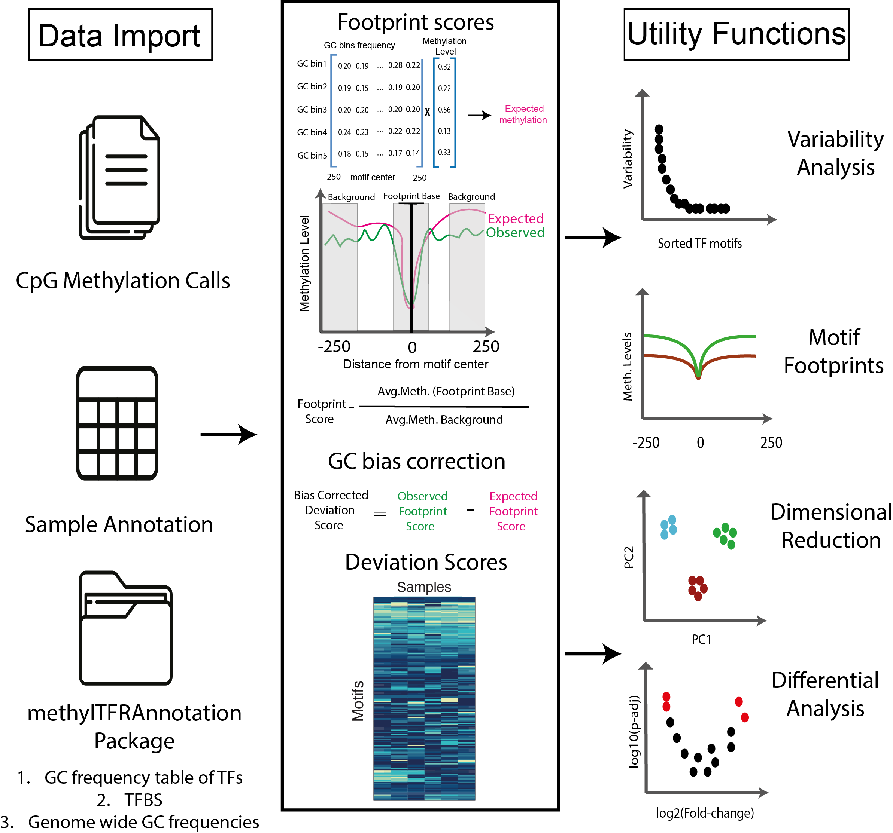

```{r setup, include = FALSE}
library(BiocStyle)
knitr::opts_chunk$set(
    collapse = TRUE,
    comment = "#>"
)
hasRnBeads <- requireNamespace("RnBeads", quietly = TRUE) &&
    requireNamespace("RnBeads.hg38", quietly = TRUE)
```

## Introduction

DNA methylation can modulate transcription factor (TF) binding, particularly
when occurring within transcription factor binding sites (TFBS). `methylTFR`
is an R package that identifies DNA methylation signatures at TFBS using
whole-genome bisulfite sequencing (WGBS) data.

For each sample, methylation levels are first aggregated across all genomic
regions corresponding to TFBS. This yields the **observed deviation**, which
captures the raw signal of methylation enrichment or depletion for each TF.
To account for sequence composition biases, `methylTFR` then estimates an
**expected deviation** using genomic background models derived from TF motif
GC content and genome-wide GC frequency. This deviation matrix provides a
compact and interpretable representation of TFBS methylation across samples,
suitable for downstream analyses such as dimensionality reduction (e.g., PCA,
UMAP), clustering, differential testing, and visualization of TF-specific
methylation footprints.

{width=80%}

### Related Bioconductor packages

| Package | Input | Output unit | Needs expression or groups? |
|---------|-------|-------------|-----------------------------|
| `r Biocpkg("chromVAR")` | Chromatin accessibility counts | Motif x sample | No |
| `r Biocpkg("ELMER")` | Methylation (mainly arrays) + expression | Probe-gene pairs, TFs | Expression and groups |
| `r Biocpkg("RnBeads")`, `r Biocpkg("methylKit")`, `r Biocpkg("DSS")`, `r Biocpkg("bsseq")`, `r Biocpkg("dmrseq")`, `r Biocpkg("DMRcate")` | CpG methylation | CpG, region or DMR | Groups for differential tests |
| `r Biocpkg("LOLA")` | Region sets (e.g. DMRs) | Enrichment per comparison | A thresholded query set |
| `r Biocpkg("viper")`, `r Biocpkg("dorothea")`, `r Biocpkg("decoupleR")` | Expression + regulons | TF x sample | Expression |
| `methylTFR` | CpG methylation | Motif x sample | No |

`methylTFR` is closest to `r Biocpkg("chromVAR")`, which scores motif
deviations per sample from chromatin accessibility; `methylTFR` does the
same from methylation, against a GC-based expectation. `r Biocpkg("ELMER")`
also infers TFs from methylation, but needs matched expression and works
on differential probes. The CpG and DMR packages give no TF-level summary,
and `methylTFR` can read an `RnBeads` object directly. `r Biocpkg("LOLA")`
returns enrichment per comparison rather than a score per sample.
Expression-based tools such as `r Biocpkg("viper")` complement
`methylTFR`. Motif matching upstream, when the annotation packages are
built, uses `r Biocpkg("motifmatchr")`, `r Biocpkg("TFBSTools")` and
`r Biocpkg("JASPAR2020")`.

## Installation

`methylTFR` is currently under review for Bioconductor. Until it is
accepted, install the development version from GitHub:

```r
if (!requireNamespace("remotes", quietly = TRUE)) {
    install.packages("remotes")
}
remotes::install_github("EpigenomeInformatics/methylTFR")
```

Once accepted, it will be installable with:

```r
if (!requireNamespace("BiocManager", quietly = TRUE)) {
    install.packages("BiocManager")
}

BiocManager::install("methylTFR")
```

## Getting Started
To get started with **methylTFR**, load the package and its dependencies:

```{r init, message = FALSE}
library(methylTFR)
```

### Read a Sample File

The `readMethylome()` function is used to import single-sample DNA
methylation data into a `GRanges` object. It supports several common file
formats, including `EPP`, `ALLC`, `BisSNP`, `bismarkCytosine`, `bismarkCov`,
and `ENCODE` bedMethyl.

You can optionally filter out low-coverage sites using the `cov_threshold`
parameter (default = 1), which excludes positions with insufficient read
support.

Below is an example of reading an example `EPP`-formatted file provided
in the package:

```{r readmethylome}
epp_path <- system.file("extdata", "epp.tsv.gz", package = "methylTFR")
epp <- readMethylome(epp_path, "EPP")
epp
```


## Annotation Resources

Computing expected deviations requires precomputed annotations for the
genome of interest: transcription factor binding sites, a genome-wide GC
distribution, and per-motif GC frequency tables. These are distributed
separately from `methylTFR`, in an annotation package named after the
assembly, for example `methylTFRAnnotationHg38`, because the binding sites
alone take several gigabytes for a full motif set.

With the annotation package installed, the three resources are retrieved
as follows:

```r
library(methylTFRAnnotationHg38)

tf_bindsites <- getTFbindsites(motifSet = "jaspar2020")
gcfreqs <- getGCfreq(motifSet = "jaspar2020")
gc_dist <- getGenomeGC()
```

To build annotations for a different assembly, motif set, or region
restriction, use
[`methylTFRAnnotationBuilder`](
    https://github.com/EpigenomeInformatics/methylTFRAnnotationBuilder).

The examples in this vignette instead use a small `BATF` subset bundled
with `methylTFR`, so they run without any annotation package.

### Input Data

`methylTFR` relies on several precomputed annotation resources to estimate
expected methylation levels at transcription factor binding sites (TFBS).
These annotations include:

- **GC distribution (`gcdist_subset`)**: Genome-wide GC content distribution
    in 30-bp windows, used to model methylation expectations.
- **Motif GC frequency (`BATF_gcfreqs`)**: GC frequency profile specific to
    the BATF motif across TFBS, used to correct for sequence composition bias.
- **TF binding sites (`BATF_tf_bindsites`)**: A `GRanges` object containing
    the genomic coordinates of BATF binding sites.
- **Example methylation data (`example_data`)**: A small subset of methylation
    calls, read with `readMethylome()`, provided for demonstration purposes.

The example methylation data in `inst/extdata` are derived from ENCODE
whole-genome bisulfite sequencing (ENCSR663MXB, GRCh38). ENCODE data are
released without restrictions. The script that creates them is
`inst/scripts/vignette_data.R`.

The following code loads these example datasets and displays the first few
entries:

```{r exdata}
load(system.file("extdata", "gcdist_subset.rda", package = "methylTFR"))
load(system.file("extdata", "BATF_gcfreqs.rda", package = "methylTFR"))
load(system.file("extdata", "BATF_tf_bindsites.rda", package = "methylTFR"))
load(system.file("extdata", "example_data.rda", package = "methylTFR"))

head(gcdist)
head(gcfreqs$BATF[, 1:5])
head(tf_bindsites)
head(msites)
```

## Compute Deviation Score for a Single Sample and Single Motif

The `computeDeviation()` function calculates the deviation score for a specific
transcription factor (TF) motif in a single sample. It compares the observed
methylation at TF binding sites (TFBS) to the expected methylation derived
from GC frequency models.

This example uses the `BATF` motif and the example methylation dataset loaded
earlier. The methylation data must first be binned by GC content using
`addGCBinToMethylome()` before computing the deviation.

```{r single_deviation}
bin_meth <- addGCBinToMethylome(msites, gcdist, ignoreStrand = TRUE)
bin_meth

deviation_score <- computeDeviation(
    motif = "BATF",
    msites = msites,
    tf_bindsites = tf_bindsites,
    gcfreqs = gcfreqs,
    enhancer = NULL,
    ignoreStrand = TRUE,
    binMsites = bin_meth
)
deviation_score
```


## Run methylTFR on multiple samples and motifs

`runMethylTFR()` runs the analysis on every sample listed in a sample
annotation file. The file must contain a column (by default `bedFile`)
with the methylation file names; all its columns become the `colData`
of the result.

To keep this example self-contained, three small samples are simulated
from the bundled data by resampling the methylated reads at each CpG, and
written to a temporary directory as `bismarkCov` files.

```{r multiple_samples}
sample_dir <- file.path(tempdir(), "methylTFR_vignette")
dir.create(sample_dir, showWarnings = FALSE)

set.seed(1)
sample_files <- paste0("sample_", 1:3, ".cov")
cov <- round(msites$coverage)
keep <- is.finite(msites$score) & msites$score >= 0 &
    msites$score <= 1 & is.finite(cov) & cov >= 1
m <- msites[keep]
cov <- cov[keep]
for (f in sample_files) {
    n_meth <- rbinom(length(m), cov, m$score)
    write.table(
        data.frame(
            chr = as.character(GenomicRanges::seqnames(m)),
            start = GenomicRanges::start(m),
            end = GenomicRanges::end(m),
            percent = 100 * n_meth / cov,
            meth = n_meth,
            unmeth = cov - n_meth
        ),
        file.path(sample_dir, f),
        sep = "\t", row.names = FALSE, col.names = FALSE, quote = FALSE
    )
}
write.table(
    data.frame(sampleName = sub(".cov", "", sample_files), bedFile = sample_files),
    file.path(sample_dir, "samples.tsv"),
    sep = "\t", row.names = FALSE, quote = FALSE
)

devs <- runMethylTFR(
    sample_ann = "samples.tsv", # file in sample_dir
    sample_dir = sample_dir, # where the methylation files are
    sampleColName = "bedFile", # column with the file names
    tf_bindsites = tf_bindsites,
    gcfreqs = gcfreqs,
    gc_dist = gcdist,
    filetype = "bismarkCov",
    threads = 1,
    chunkSize = 10
)
devs
deviations(devs)
```

For a real analysis, the annotation objects come from the annotation
package and the per-sample files are your own methylation calls; the call
is otherwise the same.

To restrict the analysis to a set of regulatory regions, pass them as a
`GRanges` through the `enhancer` argument. Here, windows of 2 kb around the
binding sites stand in for a region set:

```{r multiple_samples_enhancer}
regions <- GenomicRanges::reduce(
    GenomicRanges::resize(tf_bindsites$BATF, 2000, fix = "center")
)
devsRegions <- runMethylTFR(
    sample_ann = "samples.tsv",
    sample_dir = sample_dir,
    tf_bindsites = tf_bindsites,
    gcfreqs = gcfreqs,
    gc_dist = gcdist,
    filetype = "bismarkCov",
    enhancer = regions
)
deviations(devsRegions)
```


## Run methylTFR directly on an RnBeads object

If the methylation data has already been imported and preprocessed with
`r Biocpkg("RnBeads")`, there is no need to export per-sample files first.
`runMethylTFRFromRnBeads()` takes the `RnBSet` object directly and returns
the same `methylTFRdeviations` object as `runMethylTFR()`.

Methylation levels are read one sample column at a time, so disk-backed
sets created with `disk.dump.big.matrices = TRUE` are never loaded into
memory in full.

A preprocessed set is usually loaded with `RnBeads::load.rnb.set()`. Here,
a small `RnBiseqSet` is built from the bundled data. This chunk runs only
when `RnBeads` and `RnBeads.hg38` are installed.

```{r rnbeads, eval = hasRnBeads, message = FALSE}
library(RnBeads)

old_ids <- rnb.getOption("identifiers.column")
rnb.options(identifiers.column = "sampleName")

ids <- c("sample_1", "sample_2")
meth <- cbind(msites$score, msites$score)
covg <- cbind(msites$coverage, msites$coverage)
dimnames(meth) <- dimnames(covg) <- list(NULL, ids)

rnb_set <- RnBiseqSet(
    pheno = data.frame(sampleName = ids),
    sites = data.frame(
        chr = as.character(GenomicRanges::seqnames(msites)),
        start = GenomicRanges::start(msites),
        strand = "*"
    ),
    meth = meth,
    covg = covg,
    assembly = "hg38",
    summarize.regions = FALSE
)

devsRnb <- runMethylTFRFromRnBeads(
    rnb_set = rnb_set, # preprocessed RnBeads object
    tf_bindsites = tf_bindsites,
    gcfreqs = gcfreqs,
    gc_dist = gcdist,
    cov_threshold = 1 # minimum coverage per site
)
deviations(devsRnb)
```

Methylation calls are always read at single-cytosine resolution. Region
summaries such as `tiling1kb` or `distal` cannot be used, because a
footprint needs base-resolution calls. To restrict the analysis to a set
of regulatory regions, pass them through the `enhancer` argument:

```{r rnbeads_distal, eval = hasRnBeads, message = FALSE}
devsRnbRegions <- runMethylTFRFromRnBeads(
    rnb_set = rnb_set,
    tf_bindsites = tf_bindsites,
    gcfreqs = gcfreqs,
    gc_dist = gcdist,
    enhancer = regions
)
deviations(devsRnbRegions)

rnb.options(identifiers.column = old_ids)
```

Coverage filtering applies only to sequencing-based sets
(`RnBiseqSet`), which carry coverage information. Array-based sets are
filtered by detection p-value through `dpval_threshold`.

`RnBeads` is a suggested dependency rather than a required one, so it is
only needed if this entry point is used.

```{r cleanup, include = FALSE}
unlink(sample_dir, recursive = TRUE)
```

## Session Information
```{r session-info}
sessionInfo()
```
